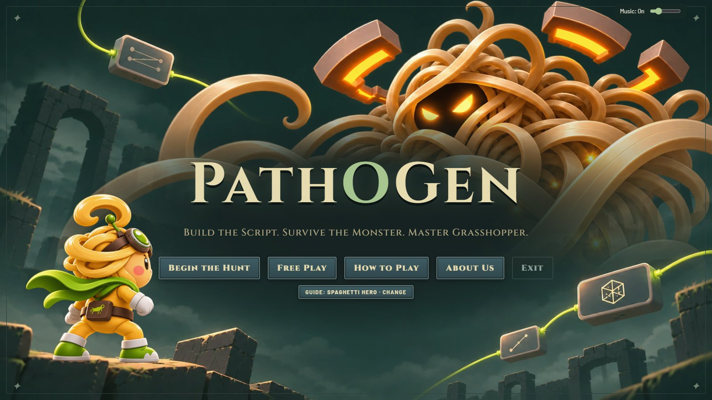
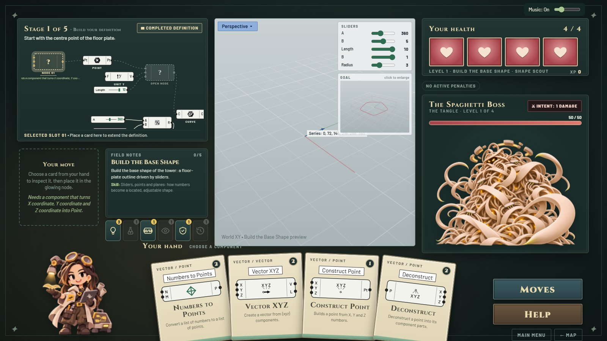
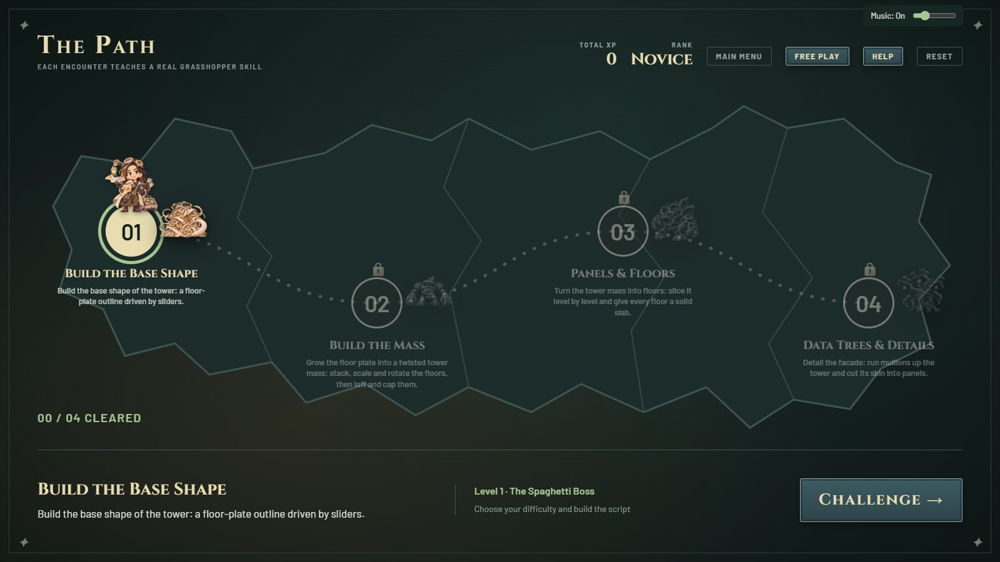
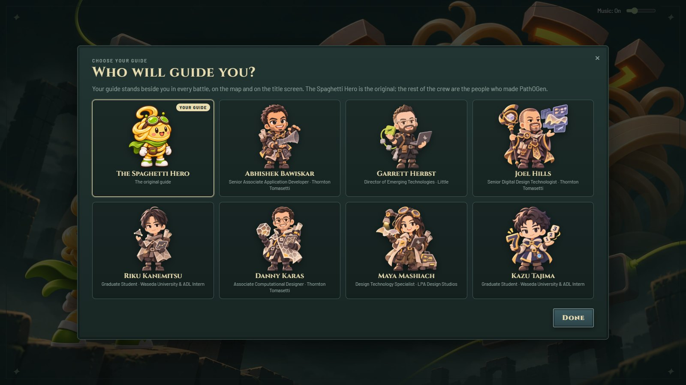

<div align="center">

# PathOGen

**Build the Script. Survive the Monster. Master Grasshopper.**

A browser game that teaches [Grasshopper](https://www.grasshopper3d.com/) by playing it.
Made at the **AECTech Hackathon 2026**.



</div>

---

## What is PathOGen?

Every level in PathOGen is a real Grasshopper definition, and a monster guards it. You fill in the definition one card at a time: pick the right **component card** for each empty node, then answer **wire checks** about which input or output a wire connects to. Finish the definition before the monster wears down your health.

Each correct card adds a real component to a working definition, and a **live 3D preview** shows the geometry your script builds. Drag the definition's sliders and the whole thing re-runs. A wrong card lets the monster attack, which can blur your view, hide component names or lock a slot. Every move, right or wrong, comes with an explanation of what the component does.



## Features

- **Real Grasshopper definitions.** Each level is transcribed from the team's own `.ghx` files and solved in the browser by a small Grasshopper-style engine. The engine handles data trees, longest-list matching and about 55 component solvers.
- **282 components** with their real inputs, outputs and Grasshopper icons.
- **Live 3D preview** with Perspective, Top and Front views, adjustable sliders and a goal image of the finished result.
- **Monsters and attacks.** Each level has its own monster, and its attacks get stronger along the path: blur, the Icon Curse (component names go missing), locked slots and timers.
- **Six lifesavers:** Hint, Health Potion, 50/50, Clear Vision, Shield and Second Chance.
- **Choose your guide.** The Spaghetti Hero, or any member of the team, stands beside you in every battle and reacts with animations when you attack, take damage, use a card or get defeated.
- **XP, stars and ranks**, saved in the browser. **Free Play** unlocks every level and difficulty at once.
- **Completed definition view.** See the finished graph and its output at any time.

<table>
  <tr>
    <td></td>
    <td></td>
  </tr>
  <tr>
    <td align="center"><sub>The Path: four encounters, each teaching a Grasshopper skill</sub></td>
    <td align="center"><sub>Pick the Spaghetti Hero or one of the team as your guide</sub></td>
  </tr>
</table>

## The Path

The four levels build one twisted tower, from a floor plate up to a detailed facade.

| # | Level | You learn | Monster | Difficulties |
|---|---|---|---|---|
| 1 | **Build the Base Shape** | Sliders, points and planes: how numbers become a located, adjustable shape | The Spaghetti Boss | 5 |
| 2 | **Build the Mass** | Vectors and transforms (Move, Rotate), then Loft and Cap Holes to make a solid | The Twisted Tower | 3 |
| 3 | **Panels & Floors** | Slicing the mass into floors and giving every floor a solid slab | The Voronoi Golem | 3 |
| 4 | **Data Trees & Details** | Running mullions up the tower and cutting its skin into panels | The Branch Tree | 3 |

There are five difficulties, from *Hopper Hatchling* through *Shape Scout*, *Pattern Pouncer* and *Geometry Wizard* to *Grasshopper Legend*. Each one is a different way of building the same result, with fewer hints, bigger hands of cards and tougher monsters as you go up.

## Play it locally

The game is plain HTML, CSS and JavaScript in [`web/`](web/), with no build step and no dependencies. It loads its levels with `fetch()`, so you need to serve the folder over http rather than open the file directly:

```bash
python -m http.server 5173 --directory web
```

Then open <http://localhost:5173>.

| URL option | What it does |
|---|---|
| `?all` | Unlocks every level |
| `?inspect` | Testing bar: jump to any level and difficulty and step through its definition stage by stage |
| `?monster=tower` | Shows one monster on every level (`spaghetti`, `tower`, `voronoi` or `tree`) |

**Keyboard:** `1`–`6` select a card, `Enter` places it, `H` uses a hint.

## Repository layout

| Path | What it holds |
|---|---|
| [`web/`](web/) | The game itself. See [`web/README.md`](web/README.md) for the code structure |
| [`web/levels/`](web/levels/) | One folder per level: `level.json` holds the component graph (the answer key), sliders and card text, plus one JSON file per difficulty |
| [`GameLevels/`](GameLevels/) | The team's Grasshopper files for each level and difficulty (`LevelA/A01.ghx` … `LevelD/D03.ghx`) |
| [`GH definitions/`](GH%20definitions/) | The original Grasshopper definitions the path is based on |
| [`Images/`](Images/) | Source art: monsters, the Spaghetti Hero, team avatars and their animation frames |
| [`godot/`](godot/) | A Godot 4 version that plays the same levels from the same data |
| [`VideoDemo/`](VideoDemo/) | Demo videos of the game |
| [`PathOGen-Game-Overview.md`](PathOGen-Game-Overview.md) | Full game design: screens, turns, attacks, lifesavers, scoring, levels |
| [`PathOGen_Level_Builder.md`](PathOGen_Level_Builder.md) | How to turn a Grasshopper definition into a level |

## Adding a level

1. Build the definition in Grasshopper and save it as `.ghx` in `GameLevels/`.
2. Convert it to a level folder in `web/levels/` (see [`PathOGen_Level_Builder.md`](PathOGen_Level_Builder.md) and [`web/levels/README.md`](web/levels/README.md)).
3. Mark the nodes the player has to fill with `"open": true` and write their hints and explanations.
4. Add the folder to `web/levels/index.json`.
5. Check it with `?inspect`, and open `web/review.html` to see any hint text still marked as draft.

## The team

<table>
  <tr>
    <td align="center" width="14%"><br><b>Abhishek Bawiskar</b><br><sub>Senior Associate Application Developer, Thornton Tomasetti</sub></td>
    <td align="center" width="14%"><br><b>Garrett Herbst</b><br><sub>Director of Emerging Technologies, Little</sub></td>
    <td align="center" width="14%"><br><b>Joel Hills</b><br><sub>Senior Digital Design Technologist, Thornton Tomasetti</sub></td>
    <td align="center" width="14%"><br><b>Riku Kanemitsu</b><br><sub>Graduate Student, Waseda University &amp; ADL Intern</sub></td>
    <td align="center" width="14%"><br><b>Danny Karas</b><br><sub>Associate Computational Designer, Thornton Tomasetti</sub></td>
    <td align="center" width="14%"><br><b>Maya Mashiach</b><br><sub>Design Technology Specialist, LPA Design Studios</sub></td>
    <td align="center" width="14%"><br><b>Kazu Tajima</b><br><sub>Graduate Student, Waseda University &amp; ADL Intern</sub></td>
  </tr>
</table>

## Credits

- Grasshopper component icons by David Rutten / Robert McNeel &amp; Associates, via [aidannewsome/grasshopper-icons](https://github.com/aidannewsome/grasshopper-icons).
- Fonts: [Cinzel](https://fonts.google.com/specimen/Cinzel) and [Barlow](https://fonts.google.com/specimen/Barlow) (SIL Open Font License).
- Grasshopper and Rhino are products of Robert McNeel &amp; Associates. PathOGen is an independent hackathon project and is not affiliated with McNeel.

## License

[MIT](LICENSE)
